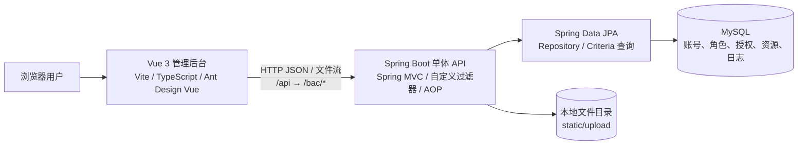

# Wety Demo 项目说明

## 1. 文档目的与项目定位

本文面向未接触过本项目的产品、实施、测试和开发人员，说明项目要解决的问题、组成结构、主要业务流程、已实现能力及其实现方式。内容依据当前仓库中的前后端源码、配置和数据库初始化脚本整理；“已实现”表示代码中存在对应实现，不代表已经在目标环境部署或完成生产验收。

本项目是一个可独立运行的企业级 Web 后台管理系统样例，提供管理后台常见的登录认证、用户与角色管理、权限配置、审计日志和文件资源能力，同时集成 Ant Design Vue Pro 风格的仪表盘、表格、表单、列表、个人页等后台界面模板。它适合作为中后台产品原型和功能底座继续扩展。

项目目前并非面向某一行业的完整业务系统：代码中没有订单、库存、客户等具体领域业务模块；用户组织架构与数据权限也仍属于规划/方案范畴，当前数据模型和接口不能视为已经实现组织架构或行级数据隔离。

## 2. 建设目的

项目的建设目标可概括为：

1. 提供一套可复用的后台管理前端，具备常见导航布局、动态路由、菜单、主题、标签页、表格和表单交互。
2. 提供与前端配套的后端基础能力，覆盖账号登录、会话校验、用户管理、角色授权、文件上传下载及操作审计。
3. 以统一接口响应和统一的请求拦截链路降低新增后台功能的接入成本。
4. 通过样例页面和基础组件展示后台系统的常见实现模式，便于验证原型或作为二次开发起点。

## 3. 系统总体架构

系统采用前后端分离的单体架构。前端是单页应用，后端是一个 Spring Boot 服务；业务数据及审计数据存储在 MySQL 中，上传文件保存在后端进程所在机器的本地目录。



### 3.1 前端

- 路径：`wety-demo-view/`
- 技术：Vue 3、TypeScript、Vite、Vue Router、Pinia、Ant Design Vue、UnoCSS、Axios。
- 入口：`src/main.ts`；应用外壳位于 `src/App.vue`，布局位于 `src/layouts/`。
- 页面按功能组织在 `src/pages/`，API 请求封装在 `src/api/`，公共请求和签名逻辑在 `src/utils/request.ts`。
- 当前路由装载支持前端静态路由和后端菜单两种模式；后端菜单接口不可用时，用户状态仓库会回退到前端路由数据。具体模式由 `VITE_APP_LOAD_ROUTE_WAY` 控制。

### 3.2 后端

- 路径：`wety-demo-api/`
- 技术：Java 8、Spring Boot 2.3.11、Spring MVC、Spring Data JPA、MySQL、Druid、Log4j2、Knife4j；密码哈希使用 BCrypt，登录请求密码使用 SM2 加密传输处理。
- 启动入口：`com.wety.demo.Application`。
- `module/` 按业务划分登录公共能力、用户管理、文件资源和审计日志；`core/` 提供过滤器、认证授权、AOP、HTTP 响应处理；`common/` 放置实体、Repository、DTO、通用响应、异常和工具。
- 服务以一个 Spring Boot 应用和一个可执行 JAR 运行，不是微服务集群。

### 3.3 数据与文件

数据库初始化脚本位于 `wety-demo-api/deploy/sql/db-init-ddl.sql`。核心表包括：

| 表 | 用途 |
| --- | --- |
| `account` | 登录账号、姓名、密码哈希、状态、联系方式和账号类型 |
| `account_session` | 账号当前会话 Token 及时间信息 |
| `role` | 角色定义 |
| `account_role_link` | 账号与角色的多对多关联 |
| `role_permission_link` | 角色与权限编码的关联 |
| `login_audit_log` | 登录、退出等登录审计信息 |
| `operation_audit_log` | 管理端请求的操作审计信息 |
| `general_resource` | 上传资源的标识、文件路径及归属关系 |

权限树本身由后端 Controller 上的权限注解定义，启动后扫描并放入内存；角色授予的权限编码则存储在 `role_permission_link` 表中。文件内容不进数据库，数据库只保存其元信息和路径。

## 4. 主要系统逻辑

### 4.1 页面访问与菜单

用户打开前端页面后，Vue Router 守卫检查浏览器本地保存的 Authorization Token。没有 Token 时，受保护页面跳转登录页；有 Token 且用户信息尚未加载时，前端调用当前账户接口获取账号和权限数据，再生成动态路由和菜单。菜单可以由前端路由生成，也可切换为后端菜单数据模式。前端还会依据路由上的权限标记过滤部分菜单和页面入口。

页面权限控制主要改善界面可见性，服务端接口是否放行取决于后端认证/授权过滤器配置；不能仅凭前端隐藏按钮或菜单推断接口受到服务端权限保护。

### 4.2 请求接入、认证和响应

前端通过 Axios 请求封装访问后端。默认接口前缀为 `/api`，本地由 Vite 代理到后端；部署时可由 Nginx 将 `/api/` 转发给 API 服务。后端业务接口以 `/bac/...` 为主。

后端 Servlet Filter 顺序为客户端 IP 同步、认证、授权、响应包装标记和 ThreadLocal 清理。认证成功后，当前账号放入请求线程上下文，服务层据此取得操作者信息。业务控制器返回的数据由统一响应包装和异常解析逻辑转换为前端可识别的结构；请求中还会记录耗时。

普通登录流程如下：

1. 前端请求验证码，后端生成图片验证码并放入 HTTP Session。
2. 用户提交登录名、密码和验证码；前端使用 SM2 将密码加密后发送。
3. 后端校验验证码，按登录名查账号，解密密码密文后用 BCrypt 与数据库哈希比对，并检查账号是否禁用。
4. 登录成功后生成 UUID Token，保存到 `account_session`，并返回账号信息和 Token；同时记录登录审计。
5. 后续 `/bac/*` 请求在请求参数中带账号名、时间戳和签名，并在 Authorization 请求头带 Token。前端按约定用 MD5 计算签名；后端校验签名、时间戳和会话有效性，更新时间以延长会话。
6. 退出时删除账号会话并更新登录日志；修改密码成功后也会退出当前会话。

### 4.3 用户、角色和权限

- 用户管理提供分页查询、新增、查询、修改和删除普通账号。新增用户的密码经过 SM2 解密后以 BCrypt 哈希保存。
- 角色管理提供角色分页、新增、修改、删除；还支持查看角色成员、关联/移除用户，以及读取/更新角色权限。
- 权限通过 `@Permission` 注解定义，支持模块级和方法级权限编码。应用启动时扫描 Controller 和方法，将 URL 与权限编码映射并构造权限树。
- 更新角色权限时，后端保存所选权限，并将其父级权限编码一并保存；普通账号的权限由其关联角色汇总。管理员账号类型在权限查询实现中直接获得扫描得到的权限编码集合。
- `@OperationLog` 注解和 AOP 用于把请求操作转换为审计记录，用户、角色和日志查询接口中可见对应配置。

当前 dev/test 配置中 `application.authentication.switch` 为 `on`，而 `application.authorization.switch` 为 `off`。因此本地配置会执行认证，但不会启用后端授权过滤器；要启用后端逐接口授权，需在部署配置中开启并结合权限注解完整性验证。权限管理 API 和前端角色权限界面存在，不等于当前默认运行模式已经强制执行所有权限检查。

### 4.4 审计日志

- 登录日志记录登录尝试结果和相关时间信息，可按分页接口查询。
- 操作日志由 AOP 在带有 `@OperationLog` 的控制器方法周围收集操作者、请求路径、HTTP 方法、客户端 IP、操作类型、描述和耗时等信息，并写入操作审计表。
- 前端提供登录日志和操作日志列表页面。

### 4.5 文件资源

上传接口将文件保存到运行目录下 `static/upload/日期/`，生成资源编码并把名称、原始名称、路径、时间等元信息写入 `general_resource`。下载时提交资源编码，后端根据记录读取本地文件并以附件流返回。Web MVC 也将 `/static/**` 映射到静态目录。该实现是单机本地存储方案，未体现对象存储或多实例共享文件方案。

## 5. 当前已实现功能清单

### 5.1 与后端业务接口关联的功能

| 功能域 | 当前实现 |
| --- | --- |
| 登录与账户 | 验证码、账号密码登录、Token 会话、查询当前账户、退出登录、修改密码 |
| 用户管理 | 普通账号分页列表、新增、详情查询、修改、删除；账号字段包含登录名、姓名、邮箱、手机号、类型和启用状态 |
| 角色管理 | 角色分页、新增、修改、删除；查看角色用户、关联和移除用户 |
| 角色权限 | 查询权限树及角色已选权限、保存角色权限 |
| 登录审计 | 登录日志分页查询 |
| 操作审计 | 操作日志分页查询、用户筛选数据和模块树查询 |
| 文件资源 | 普通文件和富文本文件上传、按资源编码下载 |
| 公共基础设施 | 统一响应/异常处理、请求耗时记录、动态权限扫描、JPA 查询支持、Knife4j API 文档配置 |

后端主要 API 前缀及接口如下（请求体字段以对应 DTO 为准）：

| API 路径 | 用途 |
| --- | --- |
| `/bac/common/getVerifyImage`、`/bac/common/login` | 获取验证码、登录 |
| `/bac/common/queryAccount`、`/bac/common/logout`、`/bac/common/editPassword` | 当前账号、退出、修改密码 |
| `/bac/userManage/user/listPageable`、`add`、`query`、`update`、`delete` | 用户管理 |
| `/bac/userManage/role/listPageable`、`add`、`update`、`delete` | 角色维护 |
| `/bac/userManage/role/queryPermission`、`updatePermission` | 查询和更新角色权限 |
| `/bac/userManage/role/listRoleUserPageable`、`listAllUser`、`addRoleUser`、`deleteRoleUser` | 角色成员管理 |
| `/bac/log/loginLog/listPageable` | 登录日志分页查询 |
| `/bac/log/operationLog/listPageable`、`listAllUser`、`queryModuleTree` | 操作日志和查询辅助数据 |
| `/bac/common/file/upload`、`uploadRichText`、`download` | 文件上传下载 |

### 5.2 前端页面

前端包含登录页、仪表盘分析/监控/工作台、基础/分步/高级表单、表格和搜索列表、用户和角色管理、登录/操作日志、个人中心与设置、权限演示页、异常页等。用户管理、角色管理、角色授权、登录日志和操作日志具备对应 API 模块；仪表盘及大量列表、表单、菜单、个人页属于后台原型/组件示例页面，不能据页面存在就认定其背后已有真实业务数据库和业务接口。

公共 UI 能力包括侧边导航、顶部栏、动态菜单、主题色和布局配置、多标签页、页面缓存、响应式查询表单/表格封装、访问控制指令和加载状态管理。

## 6. 关键实现方式

### 6.1 后端分层

一次业务请求通常按以下路径处理：

`Servlet Filter → Spring MVC Controller → Service → Repository/JPA → MySQL`

- Controller 负责路由、参数接收和 DTO/VO 传递。
- Service 负责业务规则和事务边界。
- Repository 继承 Spring Data JPA 接口；项目另有自定义 `BaseRepository`/Criteria 查询能力，用于按 DTO 组织动态查询。
- Entity 映射数据库表，DTO 接收请求，VO 返回页面需要的数据。
- `common` 提供跨模块通用设施，`core` 提供请求链路横切设施。

### 6.2 前端状态与接口

- Pinia 的用户仓库保存用户资料、菜单和路由；Token 持久化在浏览器存储中。
- Vue Router 守卫负责未登录跳转、用户信息初始化、动态路由注入和页面标题更新。
- API 文件按功能域封装请求；Axios 拦截器统一附加 Token、中文语言头、签名参数、加载状态，并处理业务错误和 401/403/500 响应。
- 表格、查询表单等常见交互由共享组件和 composable 封装，页面负责声明列、筛选条件和业务动作。

### 6.3 接口响应

后端声明了 `ResponseResult` 通用响应类型，并通过自定义 Jackson/String 消息转换器、空值包装、全局异常解析等机制处理响应。前端请求拦截器识别含 `code` 的响应，成功时向调用方返回 `data`，失败时发出通知；图片、文件流等非统一 JSON 响应走原样返回路径。

## 7. 运行和部署概览

### 前端开发

环境要求见 `wety-demo-view/package.json`：Node.js 20.15 及以上、pnpm 10.17.1。常用命令：

```bash
cd wety-demo-view
pnpm install
pnpm dev
```

前端通过环境变量配置接口前缀、开发代理目标和路由来源。README 中提供 `/api` 由 Nginx 转发至后端的示例。

### 后端运行

后端 Maven 项目默认服务端口为 6676，默认激活 `dev` profile。配置文件位于 `wety-demo-api/src/main/resources/`；`application-dev.yaml` 和 `application-test.yaml` 当前都指向本地 MySQL 示例配置。构建产物为 Spring Boot 单体 JAR，项目提供 `deploy/script/app.sh` 作为进程管理脚本，建表脚本位于 `deploy/sql/`。

正式部署前应自行设置目标数据库连接、上传域名、认证/授权开关、Swagger 开关及 Nginx 路由，并确认数据库结构与应用版本匹配。仓库中的开发配置和初始化脚本是项目样例配置，不能直接视为生产部署参数。

## 8. 当前范围与注意事项

以下事项是理解现状的重要边界：

1. 仓库 README 的“组织架构、数据权限”是计划说明，另有组织架构与数据权限实施方案文档；当前数据库实体未定义部门、岗位等组织实体，也未看到通用的数据范围过滤实现。因此当前账号/角色权限属于功能权限模型，不能等同于组织架构或数据权限。
2. 后端授权过滤器默认关闭（dev/test 配置），前端虽能按权限码过滤页面入口，真正的 API 权限拒绝还取决于部署时开启授权和权限映射覆盖情况。
3. 当前会话模型按账号保存最新会话记录，登录会覆盖账号已有 Token；这不是多端独立会话设计。
4. 文件以本地磁盘路径保存，需将文件目录纳入备份；多实例部署时各节点文件不自动共享。
5. 数据库配置包含开发用途示例值，JPA 使用 `ddl-auto: update`，初始化 SQL 含建表/初始数据逻辑。上线前需要独立设计安全的数据库迁移与凭据管理方式。
6. 后端 Maven 配置显式跳过测试执行，且已有项目分析记录未发现测试源文件；本说明未把构建或静态代码存在作为运行验收结论。
7. 当前工作区没有看到生产环境部署、目标数据库联调、备份恢复或多实例验证的证据，因此这些运行特性应在实际环境中另行验收。

## 9. 目录导航

| 路径 | 内容 |
| --- | --- |
| `wety-demo-view/src/pages/` | 前端页面 |
| `wety-demo-view/src/router/` | 静态路由、动态路由和路由守卫 |
| `wety-demo-view/src/api/` | 前端接口调用 |
| `wety-demo-view/src/components/` | 通用界面组件 |
| `wety-demo-api/src/main/java/com/wety/demo/module/` | 登录、用户、文件、审计业务模块 |
| `wety-demo-api/src/main/java/com/wety/demo/core/` | 认证授权、过滤器、AOP 和 Web 配置 |
| `wety-demo-api/src/main/java/com/wety/demo/common/` | 通用实体、数据访问、响应、异常和工具 |
| `wety-demo-api/src/main/resources/` | 应用配置和日志配置 |
| `wety-demo-api/deploy/sql/` | 数据库初始化脚本 |
| `wety-demo-api/deploy/script/` | 后端进程管理脚本 |

## 10. 总结

Wety Demo 是一个以 Vue 3 管理端和 Spring Boot 单体 API 构成的后台管理基础项目。它已经具备账号登录、用户与角色维护、角色功能权限配置、审计日志、文件资源等基础管理能力，也提供一组常见后台页面和组件样例。其定位是后台原型和基础能力底座；行业业务、组织架构、数据范围权限、生产级部署治理和多节点文件共享等仍需要在后续建设和环境验收中完成。
